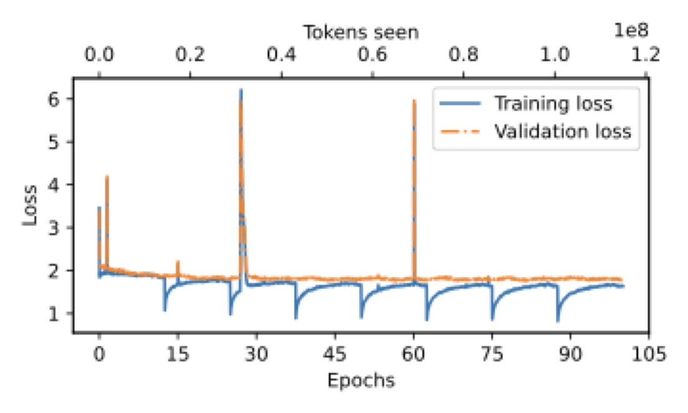

# GPT-2 Game of Thrones: build it, fine-tune it, ask it questions


A GPT-2 language model that I wrote in PyTorch, loaded with OpenAI's released weights, and kept training on all five
*A Song of Ice and Fire* books and then on question-and-answer pairs, so it answers questions about the story in full
sentences. This repository is the notebook that does the whole path, with every step explained next to its code.

[](https://colab.research.google.com/github/KaramAbuMokh/LLM-and-transformer-structure-explained/blob/main/fine_tuning_GPT2.ipynb)

**Try it:** [huggingface.co/spaces/karamAM/gpt2-demos](https://huggingface.co/spaces/karamAM/gpt2-demos) is the model running
live. Type a question about the books. It runs on free CPU hardware, so the first request after a quiet spell can take a
moment to wake it up, and an answer takes a few seconds.

## What the notebook does

1. Reads the five books from PDF into plain text and cuts the text into overlapping pieces.
2. Asks a second model (`gpt-4o-mini`) to write one fact question and one full-sentence answer for every piece.
3. Splits the data 98% / 2% into training and test sets and puts each pair into an instruction format.
4. Writes the GPT-2 network by hand (transformer block, multi-head attention, the full model) and loads OpenAI's released
   GPT-2 medium (355M) weights into it.
5. Fine-tunes it: first on the book text, then on the question-and-answer pairs, saving the best checkpoint.
6. Loads the best checkpoint and generates answers.

The notebook is also a study guide: its text cells explain the journey of a text through GPT, the transformer and
multi-head attention, one step at a time.

## What it can do today

The numbers below come from my continued fine-tuning of this model on a free Kaggle GPU (October 2026), measured on 1,233
questions from one part of *A Feast for Crows* that the continued runs never trained on.

| Measure | First model (my 2025 Colab run) | Latest model (behind the demo) |
|---|---|---|
| Answer loss on the 1,233 held-out questions (lower is better) | 2.734 | **2.119** |
| Loss over all tokens | 1.554 | **1.301** |
| Loss on an unseen book passage | 3.072 | **2.615** |
| Ends its answer by itself (10 questions, 3 tries each) | 0 of 30 | **30 of 30** |
| The 10 questions I know best, right in 2 of 3 tries | 2 | **4** |
| 30 fact questions, right in 2 of 3 tries | 10 | 10 |

A few first-try answers from the latest model: the words of House Stark, "Winter is coming" (right in 3 of 3 tries);
Arya Stark's sword, Needle (3 of 3); the mother of dragons, Daenerys (3 of 3); the sigil of House Lannister, a golden lion
on crimson (3 of 3).

It is a 355M-parameter model, so it still gets many facts wrong (for example who killed Joffrey, Hodor and the Red
Wedding). Across all 30 fact questions the score stayed at 10 of 30, so the gain is mainly complete answers that stop on
their own and a little more consistency, not new knowledge.



*Training and validation loss in one of my runs.*

## How to run it

1. Open `fine_tuning_GPT2.ipynb` in [Google Colab](https://colab.research.google.com/) and choose a GPU runtime.
2. Put your own copies of the five books as PDFs in a `data_pdf` folder (the books are not in this repository).
3. Paste your OpenAI API key into the key cell. This step calls the paid OpenAI API. Never commit a real key.
4. Run the cells from top to bottom. Checkpoints are saved to `checkpoints_txt/` and `checkpoints_qas/`, and the last cell
   loads the best one.

Python packages: `PyPDF2`, `tiktoken`, `openai`, `backoff` (installed in the first cell), plus `torch`, `numpy`,
`matplotlib` and `tensorflow` (TensorFlow only reads OpenAI's original weight files).

## Project structure

```
.
├── fine_tuning_GPT2.ipynb                  # the whole pipeline, books to fine-tuned model
├── docs/
│   └── training-loss-game-of-thrones.png   # loss plot shown above
└── README.md
```

## Notes

- This notebook is the cleaned, explained version. The run that trained the deployed model used smaller 200-character
  pieces and produced 61,650 question-and-answer pairs; the notebook here cuts 1,500-character pieces with a 200-character
  overlap, and it is saved without outputs.
- For the continued fine-tuning, the pairs were cleaned down to 34,001 and mixed with book passages in one training stream.
  That code is not in this repository.
- There is no look-up step: the model answers from what it learned, not from searching the books.

## Related

- [LLMs](https://github.com/KaramAbuMokh/LLMs): the FastAPI and Docker service that serves the model. The service behind
  the live demo has its code in the Space's Files tab.
- [fine-tune-GPT2-on-spam-email-classification](https://github.com/KaramAbuMokh/fine-tune-GPT2-on-spam-email-classification):
  the same hand-written GPT-2, re-wired into a spam classifier.
